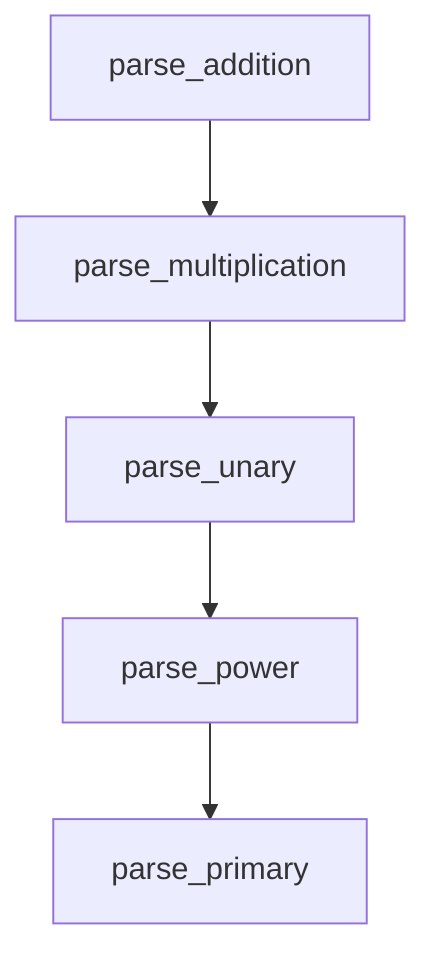

# Parser

The parser turns source strings into expression trees; it does not calculate
values or solve equations. The implementation is in
[`parser.py`](../package/typecalc/src/typecalc/parser.py), and its node types are
in [`ast.py`](../package/typecalc/src/typecalc/ast.py).

## Entry points

Import these functions from `typecalc.parser` (the package root exports only
`solve`):

| Function | Input | Result |
| --- | --- | --- |
| `parse_expression(source)` | One expression, such as `A + B*2` | An `Expression` tree |
| `parse_equation(source)` | One equation, such as `A + B = 10` | An `Equation` with `left` and `right` trees |
| `parse_equations(equations)` | A sequence of equation strings | A list of `Equation` objects, skipping blank strings |

The public `solve` function calls `parse_equations` before passing the trees to
the solver. Parsing preserves input order and does not modify the input strings.

## 1. Tokenize the source

`tokenize` uses `TOKEN_PATTERN` to extract strings, discarding whitespace between
tokens. For example, `A + B*2` becomes `["A", "+", "B", "*", "2"]`.

The pattern recognizes:

- Numbers: `\d+(?:\.\d+)?`, such as `10` or `3.14`. A decimal point must have
  digits on both sides. Signs are separate tokens, not part of a numeric token.
- Names: `[A-Za-z_]\w*`. The first character is an ASCII letter or underscore;
  later characters follow Python's Unicode-aware `\w` rules. Names are preserved
  exactly as written.
- Operators and punctuation: `+ - * / ^ @ ( ) , = | [ ]`.

After extracting tokens with `findall`, the tokenizer removes all matching text
from the original source. Any non-whitespace remainder raises `ValueError`.
This prevents unsupported characters, such as `$` in `A $ B`, from silently
vanishing.

There is no scientific-notation token, implicit multiplication, comment syntax,
or string-literal syntax. Write `0.5`, `1.0`, and `2*X`, not `.5`, `1.`, or `2X`.
`1e3` becomes adjacent number/name tokens and is rejected during parsing.

## 2. Build a tree with recursive descent

`ExpressionParser` holds the token list and a `position` cursor:

- `current()` peeks at the next token, or returns `None` at the end.
- `consume()` returns that token and advances, or raises `ValueError` at the end.
- Parse methods consume tokens without rewinding or backtracking.

Precedence comes from the order in which methods call each other. Each level
asks a tighter-binding level to parse its operands:



`parse_addition` loops over `+` and `-`. `parse_multiplication` loops over `*`,
`/`, and `@`, all at the same precedence. Both repeatedly replace their left
operand with a new `BinaryOperation`, making these operators left-associative:
`A - B - C` means `(A - B) - C`.

`parse_unary` recursively consumes leading signs. Unary `+` returns its operand
unchanged; unary `-` becomes multiplication by `Number("-1")`. There is no
separate unary-operation node.

`parse_power` reads a primary and, if followed by `^`, parses its right operand
through `parse_unary`. That recursion makes powers right-associative and allows
signed exponents:

- `2^3^2` means `2^(3^2)`.
- `-X^2` means `-(X^2)`, not `(-X)^2`.
- `X^-2` means `X^(-2)`.

`parse()` starts at `parse_addition` and then requires the token stream to be
exhausted. A valid prefix followed by extra tokens, such as `A B`, is an error.

### Primary expressions and AST nodes

`parse_primary` handles the leaves and nested expressions:

| Source form | Result |
| --- | --- |
| `3.14` | `Number("3.14")`; numeric text is retained, not converted to a float |
| `X` | `Symbol("X")` |
| `(A + B)` | The inner expression tree; parentheses do not create a node |
| `SIN(X)` | `FunctionCall("SIN", [Symbol("X")])` |
| `[A, B + 1]` | `ArrayLiteral` containing two expression trees |

Groups, array elements, and function arguments recurse into `parse_addition`,
so each can contain a full expression. A name followed by `(` is always a
function call, even with whitespace between them; `X(Y)` is not multiplication.
Function calls allow zero or more comma-separated arguments, as in `PI()` and
`LOG(X, 10)`.

Arrays require at least one element and can nest, as in `[[1, 2], [3, 4]]`.
Empty arrays and trailing commas in arrays or function calls are rejected.
The parser does not check array dimensions or rectangularity.

For example, the multiplication in `A + B*2` is built before the outer addition:

```python
from typecalc.ast import BinaryOperation, Number, Symbol
from typecalc.parser import parse_expression

assert parse_expression("A + B*2") == BinaryOperation(
    left=Symbol("A"),
    operator="+",
    right=BinaryOperation(Symbol("B"), "*", Number("2")),
)
```

### DIFF evaluation-point shorthand

`parse_function_call` has one special syntax rule:

```text
DIFF(X^2 | X=10)
```

It produces the same tree as `DIFF(X^2, X, 10)`: an ordinary `FunctionCall`
with the expression, a `Symbol` for the variable, and the point expression as
its three arguments. The point can itself be an expression, such as `P + 1`.

The `|` is allowed only after the first argument of a call whose name is
`DIFF`, compared case-insensitively. It must be followed by a single variable
name, `=`, the point expression, and the closing `)`. The original spelling of
the function name is still stored in the tree. This is not general keyword
argument syntax or a general-purpose `|` operator.

## 3. Parse equations and input lines

`parse_equation` uses the same token cursor to:

1. Parse the left side with `parse_addition`.
2. Require and consume an outer `=`.
3. Parse the right side with `parse_addition`.
4. Reject another outer `=` or any remaining tokens.
5. Return `Equation(left=left, right=right)`.

It does not split the source string on `=`. This matters for
`A = DIFF(X^2 | X=10)`: the function-call parser consumes the inner equality
as part of the shorthand, leaving only the outer equality for the equation
parser. General equality expressions and chained equations such as `A = B = C`
are not supported.

`parse_equations` treats each sequence element as one input line; it does not
split a multiline string. It rejects a bare `str` or `bytes` with `TypeError`,
and rejects non-string elements with a line-numbered `TypeError`. Blank elements
are skipped, but still count toward the original 1-based line numbers.

## Errors and the parser's boundary

Syntax errors raise `ValueError`: unknown characters, unexpected tokens,
missing operands or delimiters, malformed DIFF shorthand, and missing or
repeated outer equality signs. There is no recovery after an error.
`parse_equations` adds `Line N:` to the first parsing error and preserves its
original exception as the cause. For example, `["", "A = 1", "B ="]` reports
`Line 3: Unexpected end of expression`. Errors do not include column positions.

A valid tree is not necessarily valid mathematics. The parser records function
names and arguments without looking them up or checking ordinary function
arity; for example, both `UNKNOWN(1)` and `SIN()` parse successfully. Function
validation, array-shape checks, evaluation, and solving happen downstream.
See [Backend](backend.md) for that pipeline and the
[reference](reference.md) for supported mathematical operations and limitations.
